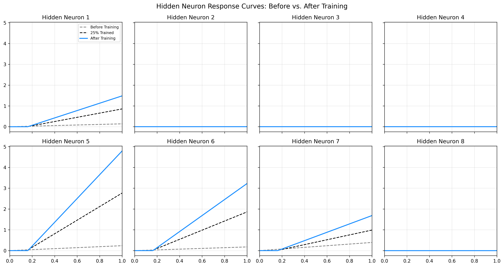
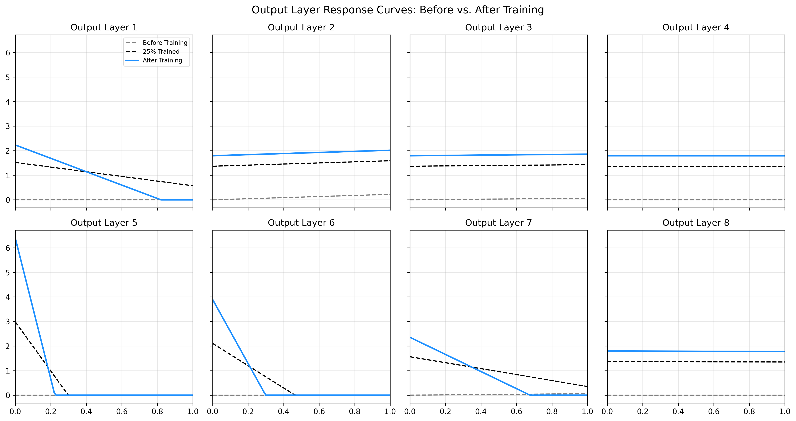

# String AI
Simple neural network created from a scratch without any libraries. Goal of this project 
is to learn the mathematical fundamentals of AI. This is to be done via exploration where
all the parameters are played around with to see how they influence performance and
predictions down to the per-neuron level.

The AI engine is stored under *src* and performance metrics under *lib*.


## Project structure
This project constitutes of:
- Generator: Creates a dataset for training
- Network: Creates neurons with weights and biases
- Forward: Generates a prediction
- Backward: Rebalances the neurons

Run a full cycle from dataset generation to training to testing:
> python3 mini.py


## Observations: Dataset
If the dataset doesn't have a balanced number of samples with and without Target, the network 
will take a lazy shortcut and start predicting either 1 or 2 for everything. This can be 
observed in the overall loss dropping very low immediately across the dataset.
```
Start training for 200 epochs...
Epoch 20/200 | Average Loss: 0.01940
Epoch 40/200 | Average Loss: 0.01930
Epoch 60/200 | Average Loss: 0.01928

--- Testing Network Predictions After Training ---
String: 'e' | Target: 1.0 | Prediction: 0.0683
String: 'i' | Target: 0.0 | Prediction: 0.0441
```

Whereas with approximately 50% balance across the dataset:
```
Start training for 200 epochs...
Epoch 20/200 | Average Loss: 0.04723
Epoch 40/200 | Average Loss: 0.04415
Epoch 60/200 | Average Loss: 0.04195

--- Testing Network Predictions After Training ---
String: 'e' | Target: 1.0 | Prediction: 0.9440
String: 'l' | Target: 0.0 | Prediction: 0.0000
```

## Observations: Neurons
During training, approximately half of the hidden neurons in the layer flatline and become 
permanently inactive - a classic manifestation of the **Dying ReLU problem**.



### Why Do Neurons Die?
1. **Unidirectional Gradient Cuts**: A ReLU activation function evaluates to $f(z) = \max(0, z)$ 
   with a derivative of $1.0$ for $z > 0$ and $0.0$ for $z \le 0$. If a step during gradient 
   descent pushes a neuron's weight ($W_1$) or bias ($b_1$) far enough negative that its output 
   is non-positive across the entire input domain ($x \in [0, 1]$), the gradient drops to 
   exactly zero. Once zeroed out, backpropagation can no longer pass error signals to those 
   weights, permanently locking the neuron out of future updates.
2. **Selective Survival**: Neurons that survive typically start with positive biases or lucky 
   initial weight alignments, keeping their outputs above zero long enough to receive continuous 
   gradient updates.

### Key Insights
* **Automatic Capacity Pruning**: Even though 8 hidden neurons are provided, the network 
  automatically "prunes" its unused capacity. For a simple 1D decision window, only a few active 
  rising and falling ramps are required to isolate the target character. The redundant neurons 
  simply die off rather than contributing noise.
* **Geometric Asymmetry**: Rising ramps ($W_1 > 0$) survive far more easily than falling ramps 
  ($W_1 < 0$) because falling ramps start active for all lower-valued inputs ($x = 0$), 
  accumulating errors across wrong predictions early in training unless carefully counterbalanced.

This behavior highlights a core trade-off when building network architectures from scratch: high 
capacity offers flexibility, but standard ReLU activations leave excess capacity vulnerable to 
permanent gradient starvation.


## Observations: Outputs
When plotting the individual hidden neurons scaled by their respective output weights ($W_2$), a 
distinct geometric pattern emerges: many of the surviving curves appear as falling curves, with 
some possibly exhibiting exceptionally sharp slopes.



### Why Falling Curves?
Output Weight Inversion ($W_2$ Multiplication): While the underlying hidden neurons naturally 
learn rising ramps ($W_1 > 0$), their actual contribution to the final network depends on $W_2$. 
If $W_2$ is negative, it multiplies and inverts the positive ramp, transforming a rising slope 
into a falling curve.

Sharp Transitions: Certain neurons display very steep, aggressive slopes. 
This occurs when gradient descent drives up the magnitude of $W_1$ or $W_2$, allowing the 
network to carve out a razor-sharp boundary rather than a gradual slope.

### Key Insights
Asymmetric Building Blocks: The network achieves its decision boundary not by using raw rising 
ramps alone, but by combining inverted, falling contributions. It uses positive $W_2$ neurons to 
lift the prediction window up at the target's starting edge, and negative $W_2$ neurons with 
sharp falling slopes to slam the prediction back down once the target character ends.Cooperative 

Cancellation: By balancing positive and negative scaled outputs across the hidden layer, the 
network constructs a localized "bump" or window function capable of isolating the target 
character amidst a sea of non-target inputs.
